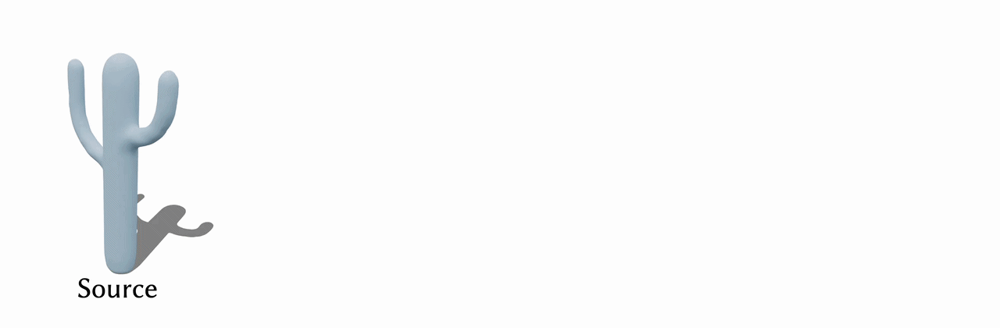

# Rotation-Equivariant Neural Jacobian Fields for Generalizable 3D Mesh Deformations



### SIGGRAPH Asia 2026

#### [📝 Preprint](https://lukas.uzolas.com/assets/pdf/Re-NJF_2026_compressed.pdf)

**[Lukas Uzolas](https://lukas.uzolas.com/)<sup>1</sup>, 
[Ruben Wiersma](https://rubenwiersma.nl/)<sup>2,3</sup>,
[Olga Sorkine-Hornung](https://igl.ethz.ch/people/sorkine/)<sup>2</sup>,
[Petr Kellnhofer](https://kellnhofer.xyz/)<sup>1</sup>**
<br>
TU Delft<sup>1</sup>, ETH Zurich<sup>2</sup>, Adobe Research<sup>3</sup>
<br>


Neural Jacobian Fields are state-of-the-art neural representations for deformations on 3D meshes.
A fundamental limitation of both the original formulation and follow-up works is that the learned Jacobians are not equivariant to ambient-space rotations of the source mesh. 
This hinders generalization to shapes that are misaligned or greatly different in shape.
Moreover, our analysis shows that this rotation dependence stems from the formulation itself and cannot be remedied with rotation-invariant features alone.
Instead, we propose a rotation-equivariant formulation of Neural Jacobian Fields, Re-NJF, representing Jacobians in local frames of triangle faces aligned with their normals.
The frames are learned end-to-end in the gradient space of semantic surface features distilled from 2D image foundation models. 
Robust to rotations and large geometry changes, these features support learning tangent frames and Jacobians that generalize across transformations in SO(3). 
Moreover, our localized tangent frame definition also facilitates generalization to non-rigid transformations of the input and substantial shape changes (e.g., dog to human).
We evaluate our method on human and animal pose deformation datasets to simultaneously demonstrate competitive performance in the well-explored aligned data regime, as well as superior performance in tasks requiring generalization across ambient space rotations and input shape variations.


## Code

We provide pre-trained networks (`results/trained_model`), demo meshes (`./data/demo`), and visualization scripts that can be used to replicate results from our paper.

### Setup repository
Clone the repository and run ```git submodule update --init --recursive```.

### Create environment
Dependencies are easiest installed with UV.
```sh
CUDA=cu126 # Check your CUDA version
uv venv -p 3.12 .venv
source .venv/bin/activate
uv pip install torch torchvision --index-url https://download.pytorch.org/whl/$CUDA
uv pip install pyrender libigl cholespy einops scipy matplotlib tqdm trimesh pillow 'smplx[all]' pandas omegaconf pyfmaps torch-geometric roma pip fast-simplification polyscope 'imageio[ffmpeg]'
uv pip install --no-build-isolation git+https://github.com/ArmanMaesumi/torch_mesh_ops
uv pip install chumpy --no-build-isolation
```
The installation of `torch_mesh_ops` could crash when it runs out of memory while compiling. You can fix this by setting `MAX_JOBS=1` before running the `uv pip install` command.


### Usage

#### Toy example
To recreate the figures and results for the toy example, simply run the following command:
```sh
python -m experiments.toy_example.run
```
The output will be saved to `./results/toy_example`.

#### Generalized reposing

##### Interactive reposing
You can compare ours against VectorMLP_S by running the interactive reposing tool:
```sh
python -m experiments.repose.visualize_interactive \
       --results_dir results/trained_model/ours/ results/trained_model/vector_mlp_semantic/ \
       --mesh data/demo/spot.obj
```
To repose the mesh, click on Bone Angles (deg) and choose a slider of a bone that you want to modify. To apply a global rotation to the mesh, use the Rotation X/Y/Z (deg) at the top. To change between the input skeleton, press SMPL or SMAL at the top.

Due to licensing restrictions, the template shapes (SMPL/SMAL) cannot be distributed with this demo, so the reference skeleton panel is unavailable here. The publicly released repository will include the complete GUI as demonstrated in the video.

You can modify the input mesh by passing another .obj file from the demo folder, e.g.,--mesh data/demo/cow.obj. And to compare against VectorMLP_XYZ, you can add results/trained_model/vector_mlp_xyz/ to --results_dir.


#### Inverse Kinematics
```sh
python -m experiments.pseudo_ik.run \
       --results_dir results/trained_model/ours/ \
       --mesh data/demo/beast.obj \
       --mode smpl
```
To load one of the experiments from the paper, press "Load experiment" (it should default to "beast thumb") and then "Optimize". Try rotating or shifting the target during the optimization".
You can replace `results/trained_model/ours/` with `results/trained_model/vector_mlp_semantic/` or `results/trained_model/vector_mlp_xyz/` to replicate results for the baselines.

## Feature extraction

To extract the semantic features for new meshes use [scripts/process_features.py](https://github.com/lukasuz/SurfaceAware3DFeaturesCode) script from the Surface-Aware Distilled 3D Semantic Features repository.


## Citation

```
@inproceedings{10.1145/3829340.3842184,
    author = {Uzolas, Lukas and Wiersma, Ruben and Sorkine-Hornung, Olga and Kellnhofer, Petr},
    title = {Rotation-Equivariant Neural Jacobian Fields for Generalizable 3D Mesh Deformations},
    year = {2026},
    isbn = {9798400728426},
    publisher = {Association for Computing Machinery},
    address = {New York, NY, USA},
    url = {https://doi.org/10.1145/3829340.3842184},
    doi = {10.1145/3829340.3842184},
    booktitle = {Proceedings of the SIGGRAPH Asia 2026 Conference Papers},
    keywords  = {Neural Fields, Semantic Features, Pose Transfer},
    location  = {Kuala Lumpur, Malaysia}
    series = {SA Conference Papers '26}
}
```
